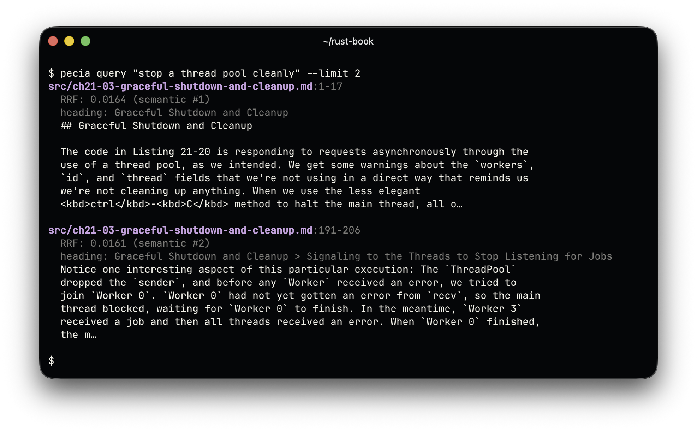

<p align="center">
  
</p>

<p align="center"><a href="README.md">English</a> · <b>Türkçe</b></p>

<p align="center">
  
</p>

Pecia, bir klasördeki belgeleri ve kaynak kodunu aranabilir bir indekse dönüştüren yerel bir arama aracıdır. Klasörü dolaşır, metni anlamlı parçalara (chunk) böler ve bunları projenizin yanında duran tek bir SQLite dosyasında saklar; böylece BM25 ile çevrimdışı arama yapılabilir. Semantik indeksleme açıkken her parçayı aynı süreçte çalışan küçük bir modelle vektöre dönüştürür; sorgular kelimelerin yanında anlamdan da eşleşebilir.

## Durum

**v0.1**, ilk sürüm. Pecia UTF-8 metin belgelerinde ve kaynak kodunda arama yapar; sonraki sürümlerde başka biçimler eklenmesi planlanıyor.

- Proje başlatma ve TOML yapılandırması.
- `.gitignore`, dahil etme ve hariç tutma filtreleri ve `--dry-run` ile dosya keşfi.
- Doğrulanmış UTF-8 metin okuma ve SHA-256 içerik özeti.
- Paketle gelen çevrimdışı tokenizer ile metin, Markdown ve kaynak kodu için token bütçeli bölme.
- Dosyaların atomik olarak değiştirildiği, FTS5 indeksinin senkron tutulduğu SQLite depolama.
- Artımlı indeksleme: değişmeyen dosyalar atlanır, silinen dosyalar kaldırılır.
- Kararlı chunk kimlikleri; okuma, tokenizer ve bölme ayarları için sürümlü uyumluluk.
- Yolları, satır aralıklarını, skorları, başlıkları ve önizlemeleri gösteren çevrimdışı BM25 araması.
- İsteğe bağlı semantik indeksleme: all-MiniLM-L6-v2 modeli ilk kullanımda bir kez indirilir, doğrulanır ve önbelleğe alınır.
- Vektör depolama, kaldığı yerden devam eden embedding tamamlama ve model değişince yeniden oluşturma.
- sqlite-vec ile semantik arama, reciprocal rank fusion ile BM25 ve vektör sıralamalarını birleştiren hybrid arama ve `auto` modu.
- Belleği sınırlı paralel embedding; Ctrl+C ile temiz biçimde duran indeksleme.
- Hata yalıtımı: okunamayan klasörler ve okunamayan ya da embedding'i yapılamayan dosyalar raporlanır, geri kalan her şey indekslenir; depolama hataları ne yapılacağını söyler; yarıda kalan ya da öldürülen bir çalıştırma bir sonrakinde toparlanır.
- Yeniden kullanılabilir Java core API'si ve `init`, `index`, `query` komutlarıyla çalıştırılabilir JAR.
- İndeksleme, sorgu ve deneme çalıştırmaları için JSON çıktısı; vurgulama için eşleşme aralıkları.
- Ayrıntılı deneme çalıştırmaları, canlı ilerleme, gruplanmış özetler ve renkli, okunaklı terminal çıktısı.
- Paketlenmiş uygulamanın gerçek modelle uçtan uca testleri ve CI'da denetlenen arama kalitesi ölçümleri.
- macOS, Linux ve Windows için Java çalışma zamanını içeren, Homebrew ya da Scoop ile kurulan paketler.

### Planlananlar

- Grafik arayüzlü bir masaüstü uygulaması.
- Kaynak kodunu satır ve girinti yerine fonksiyon ve sınıf sınırlarından bölen, dile duyarlı bölme.
- JSON, YAML ve reStructuredText gibi daha fazla metin biçimine göre ayarlanmış bölme.
- Daha fazla dosya türü: PDF, Word ve Excel belgeleri ve resimler.
- Yapay zekâ agent'larının bir projeyi Pecia üzerinden arayabilmesi için bir MCP sunucusu.

## Kurulum

Paketler kendi Java çalışma zamanlarını içerir; Java kurmanız gerekmez.

| Sistem | Kurulum |
| --- | --- |
| macOS (Apple silicon), Linux (x64, arm64) | `brew install eyuppastirmaci/pecia/pecia` |
| Windows (x64) | `scoop bucket add pecia https://github.com/eyuppastirmaci/scoop-pecia`, ardından `scoop install pecia` |

[Installing Pecia](docs/install.md) (İngilizce) [Releases](https://github.com/eyuppastirmaci/pecia/releases) sayfasındaki arşivlerle kurulumu, güncellemeyi, güvenlik uyarılarını ve JAR'ın Java 21 veya üstüyle çalıştırılmasını anlatır. ONNX Runtime desteklemediği için Intel Mac'ler için paket yoktur.

### Kaynaktan kurulum

Git ve JDK 21 ile repoyu klonlayıp Pecia JAR'ını derleyin:

```
git clone https://github.com/eyuppastirmaci/pecia.git
cd pecia
./gradlew :pecia-cli:shadowJar
java -jar pecia-cli/build/libs/pecia.jar --version
```

Belgelerde `pecia` yazan her yerde `java -jar pecia-cli/build/libs/pecia.jar` kullanın. Bunun yerine Java gerektirmeyen bir paket isterseniz `./gradlew :pecia-cli:packageArchive` komutunu çalıştırın, `pecia-cli/build/package/dist` klasörüne yazılan arşivi açın ve içindeki `bin` klasörünü `PATH`'e ekleyin. Windows'ta `gradlew.bat` kullanın. Testler ve kontroller [CONTRIBUTING.md](CONTRIBUTING.md) dosyasında (İngilizce) anlatılır.

## Kullanım

### Hızlı başlangıç

```
pecia --help                             # komutları listeler
pecia --version                          # sürümü yazar
pecia init                               # bulunulan klasöre varsayılan .pecia.toml yazar
pecia index . --dry-run                  # indekslemenin neyi değiştireceğini gösterir, hiçbir şey yazmaz
pecia index .                            # yerel lexical indeksi oluşturur
pecia index . --semantic                 # embedding'leri de oluşturur (model bir kez iner)
pecia index . --progress=plain           # ilerlemeyi loglar için düz satırlar olarak yazar
pecia query "authentication middleware"  # varsayılan auto modunda arar
pecia query "JWT_SECRET" --mode lexical --root /path/to/project --limit 5
pecia query "how are refunds paid?" --mode semantic
pecia query "refund policy" --json       # betikler için tek bir JSON belgesi
```

`query`'den önce `index` çalıştırın. Kaynaktan derlediyseniz `pecia` yerine `java -jar pecia-cli/build/libs/pecia.jar` kullanın. Her komut `--help` ve `--color=auto|always|never` seçeneklerini kabul eder; bkz. [Colour](docs/cli.md#colour).

### Komutlar

| Komut | Ne yapar | Başlıca seçenekler |
| --- | --- | --- |
| `init` | Bulunulan klasörde yoksa varsayılan bir `.pecia.toml` yazar. | — |
| `index [folder]` | Klasördeki dosyaları (varsayılan: bulunulan klasör), en yakın `.pecia.toml` ya da Git kökünden bulunan projenin indeksine ekler: yeni ve değişen dosyaları ekler, silinenleri kaldırır, değişmeyenleri atlar. Semantik indeksleme açıkken yeni chunk'ların ve henüz embedding'i olmayan kayıtlı chunk'ların embedding'lerini de yapar. | `--dry-run`, `--semantic` / `--no-semantic`, `--progress`, `--json` |
| `query <text>` | Mevcut indeksi kaynak dosyaları yeniden okumadan, salt okunur biçimde arar ve en iyi eşleşen chunk'ları yazar. Birden fazla kelimeyi tırnak içine alın. | `--mode`, `--limit`, `--root`, `--json` |

[Command reference](docs/cli.md) (İngilizce) her seçeneği, çıktı biçimlerini, çıkış kodlarını, hataları, yapılandırmayı ve model önbelleğini anlatır. Pecia'yı Java'dan kullanmak için bkz. [Using pecia-core from Java](docs/library.md).

## Desteklenen dosyalar

Pecia en fazla 5 MiB büyüklüğündeki (`index.max_file_bytes`) UTF-8 metin dosyalarını indeksler:

| Tür | Dosyalar |
| --- | --- |
| Markdown | `.md`, `.markdown` |
| Düz metin | `.txt`, `.rst`, `.adoc` ve adı `README`, `LICENSE`, `LICENCE`, `NOTICE`, `CHANGELOG`, `AUTHORS` ya da `CONTRIBUTING` olan dosyalar |
| Kaynak kodu | `.java`, `.kt`, `.kts`, `.py`, `.pyi`, `.js`, `.jsx`, `.mjs`, `.cjs`, `.ts`, `.tsx`, `.mts`, `.cts`, `.c`, `.h`, `.cc`, `.cpp`, `.cxx`, `.hh`, `.hpp`, `.hxx`, `.cs`, `.go`, `.rs`, `.rb`, `.php`, `.swift`, `.sh`, `.bash`, `.zsh`, `.ps1`, `.psm1`, `.bat`, `.cmd`, `.sql`, `.css`, `.scss`, `.sass`, `.less` ve adı `Dockerfile`, `Containerfile`, `Makefile` ya da `Jenkinsfile` olan dosyalar |
| Yapılandırılmış metin | `.json`, `.jsonc`, `.yaml`, `.yml`, `.toml`, `.ini`, `.cfg`, `.properties`, `.xml` |

Varsayılan olarak derleme ve bağımlılık klasörlerini (`build` ve `node_modules` gibi), küçültülmüş dosyaları, kilit dosyalarını ve `.env` dosyalarını atlar; bu kurallar `.pecia.toml` dosyasında listelenir ve değiştirilebilir (bkz. [Configuration](docs/cli.md#configuration)). Geçerli UTF-8 olmayan ya da ikili veri içeren dosyalar raporlanır ve dışarıda bırakılır.

## Gizlilik ve çevrimdışı kullanım

Pecia tamamen bilgisayarınızda çalışır. Telemetri göndermez; dosyalarınızı, indeksinizi ya da sorgularınızı hiçbir yere yüklemez.

Tek ağ erişimi ilk semantik indekslemedir: model Hugging Face'ten indirilir ve sabitlenmiş boyutu ile SHA-256'sı kontrol edilir. Lexical indeksleme ve bütün sorgular çevrimdışı çalışır. Proxy arkasındaysanız `https_proxy` ayarlayın; bkz. [Model cache](docs/cli.md#model-cache).

Projenizdeki indeks, `.pecia/index.db`, indekslenen metnin kopyalarını tutar; onu dosyaların kendisi kadar gizli tutun. `.pecia/` klasörünü silmek indeksi kaldırır.

## Disk kullanımı

| Ne | Nerede | Boyut |
| --- | --- | --- |
| Paket | Homebrew'un, Scoop'un ya da sizin kurduğunuz yer | yaklaşık 57 MB |
| İndeks | her projede `.pecia/index.db` | indekslenen metinle büyür: Pecia'nın kendi 577 kaynak ve belge dosyası (7.119 chunk) 15 MB, embedding'lerle 29 MB tutar |
| Model | bütün projelerin paylaştığı [model önbelleği](docs/cli.md#model-cache) | ilk semantik çalıştırmadan sonra yaklaşık 86 MB |
| ONNX Runtime ve sqlite-vec | model önbelleği | ilk semantik çalıştırmadan sonra yaklaşık 38 MB |

## Bilinen sınırlamalar

- Yalnızca yukarıdaki UTF-8 metin biçimleri indekslenir; PDF, Office belgeleri, resimler, ses ve video indekslenmez.
- Semantik model ağırlıklı olarak İngilizce metinle eğitildi; Türkçe dahil diğer dilleri anlamdan daha zayıf eşleştirir. Lexical arama her dilde çalışır.
- Lexical bir sorgu en fazla 64 kelime içerebilir; daha uzunu reddedilir, daha uzun bir hybrid sorgu ise yalnızca semantik tarafla sıralanır. Semantik sorgunun yalnızca ilk 256 token'ı kullanılır. Bir sorgu kısaltıldığında ya da bir taraf atlandığında Pecia bunu bildirir.
- İndeks yalnızca `index` çalıştığında değişir; Pecia dosyaları izlemez.
- Intel Mac'ler için paket yoktur; semantik arama yalnızca ONNX Runtime'ın çalıştığı yerlerde çalışır: Linux x64 ve arm64, Apple silicon macOS ve Windows x64.
- Paketler imzalı değildir; bkz. [security prompts](docs/install.md#macos-security-prompts). Windows'ta `java -jar`, sistem kod sayfası dışındaki sorgu karakterlerini kaybeder ve komut önerileri PowerShell tırnaklamasını kullanır; bkz. [Installing Pecia](docs/install.md).

## Nasıl çalışır

### 📂 Dosya keşfi

Pecia dosyaları `.gitignore` kurallarına ve `.pecia.toml` dosyasındaki dahil etme ve hariç tutma kalıplarına göre seçer. Sembolik bağlantıları, kendi indeks dosyalarını ve dahil etme kalıplarının kabul edemediği `.pecia.toml` yapılandırma dosyalarını atlar; `--dry-run` bu seçimi ve indekslemenin neyi değiştireceğini önceden gösterir.

### ✂️ Okuma ve bölme

Desteklenen metin dosyaları boyut ve UTF-8 doğrulamasıyla okunur, ardından yapılandırılan token bütçesine göre bölünür. Bütçeden, aşağıda anlatılan embedding bağlam satırı için 32 token ayrılır; varsayılan 256 token'lık bütçe en fazla 224 token'lık chunk'lar verir. Chunk'lar kaynak yollarını, satır aralıklarını ve varsa Markdown başlık bağlamını korur. Tek kısa satırlı bir başlık gibi küçük bir Markdown bölümü ya da bölünmek zorunda kalan uzun bir listenin birkaç maddesi, aynı üst başlık altındaki komşu bölüme katılır; böylece hiçbir chunk tek başına bir şey anlatamayacak kadar küçük kalmaz. Eski bağlantılar için tutulan bir çapa gibi yalnızca HTML işaretlemesinden oluşan bir blok hiç indekslenmez.

### 🗃️ Yerel indeksleme

Dosya bilgileri ve chunk'lar SQLite'ta saklanır; metin araması için FTS5 senkron tutulur. Her dosya atomik olarak değiştirilir: başarısız bir değiştirme önceki veriyi korur, daha önce başarılı olan dosyalar indekste kalır. Silinen dosyalar yalnızca bulduğu her dosyayı ve klasörü okuyabilen bir çalıştırmadan sonra kaldırılır; böylece okunamayan bir dosya asla silinmiş sanılmaz.

İndeksleme, bir dosyayı atlayıp atlamamaya karar vermeden önce güncel kaynağı doğrular ve özetini çıkarır. İçerik, belge türü ve bölme ayarlarının tamamı aynıysa okuma ve yazma atlanır; boş dosyalar dahil. Okuma ya da bölme sürümlerinin, tokenizer davranışının ya da token bütçelerinin değişmesi dosyaların yeniden işlenmesini gerektirir; yalnızca model adının ya da revizyonunun değişmesi bölme uyumluluğunu etkilemez.

İndekslenen her chunk'ın, projeye göre yolundan, sıfırdan başlayan sırasından ve bölme profilinden türetilen deterministik bir SHA-256 kimliği vardır. Kimlikler projeye özgüdür ve içeriği kapsamaz: aynı konumdaki bir düzenleme kimliği koruyabilir, güncellik ise ayrı bir dosya özetiyle izlenir. Java core'da bu kimlik `StoredChunk.stableId()` ve `SearchHit.stableId()` olarak sunulur. Sayısal veritabanı kimlikleri yalnızca yerel satır göstericileridir. Eski ya da geçersizleşmiş kayıtlar, yeniden indeksleme tam bir profil oluşturana kadar boş bir kararlı kimlikle aranabilir kalır.

### 🧠 Embedding'ler

Semantik indeksleme her chunk'ı ONNX Runtime ile CPU üzerinde [all-MiniLM-L6-v2](https://huggingface.co/sentence-transformers/all-MiniLM-L6-v2) modelinden geçirir ve chunk başına 384 boyutlu bir birim vektör üretir. Modele verilen metin bir bağlam satırıyla başlar: chunk'ın yolu ve başlık yolu (örneğin `bridge/README.md > Intent`), ardından boş bir satır ve içerik. Böylece bir chunk, dosyasının ve bölümünün konusuyla da bulunur; arama sonuçları ve lexical arama yalnızca içeriği gösterir. Vektörler chunk'ın yanında, aynı SQLite dosyasında saklanır. Değişen dosyalar indekslenirken, dosyalar okunmaya devam ederken tek bir modeli paylaşan `embed.concurrency` sayıda işçi tarafından embedding'e dönüştürülür. Dosyalar işçi sayısı ne olursa olsun aynı sırayla yazılır ve yazılmayı en fazla 128 chunk bekler; böylece proje ne kadar büyük olursa olsun bellek sınırlı kalır. Embedding'i olmayan kayıtlı chunk'lar, örneğin önceki lexical çalıştırmalardan kalanlar, indeksten kendi başına commit edilen sayfalar halinde işlenir; yarıda kalan bir çalıştırma kaldığı yerden devam eder. Her embedding hangi model, revizyon, tokenizer ve girdiyle yapıldığını kaydeder; bunlar değişince bir sonraki semantik çalıştırma eski embedding'leri yeniler, yalnızca model değiştiyse chunk'lar yeniden kullanılır.

### 🔎 Arama

`query` mevcut indeksi salt okunur açar ve kaynak dosyaları asla yeniden okumaz. Lexical arama BM25 sıralamalı FTS5 kullanır. Semantik arama sorguyu aynı modelle vektöre dönüştürür ve embedding'i olan chunk'ları [sqlite-vec](https://github.com/asg017/sqlite-vec) ile kosinüs benzerliğine göre sıralar; sqlite-vec yalnızca semantik ve hybrid sorgularda yüklenir. Hybrid arama iki sıralamayı da indeksin tek ve tutarlı bir anlık görüntüsünden okur ve ham skorları değil sıraları birleştirir; böylece hiçbir ölçek diğerine baskın gelmez. Sonuçlar projeye göre yolları, satır aralıklarını, skorları, varsa başlıkları ve kısa metin önizlemelerini gösterir; lexical olarak bulunan bir chunk'ın önizlemesi eşleşen kelimelerin çevresinden alınır.

## Paketle gelen bileşenler

- **Tokenizer sözlüğü.** Çevrimdışı token sayımı, [all-MiniLM-L6-v2](https://huggingface.co/sentence-transformers/all-MiniLM-L6-v2/tree/1110a243fdf4706b3f48f1d95db1a4f5529b4d41) modelinin 30.522 girdilik `vocab.txt` dosyasını kullanır; dosya JAR'ın içindedir (yaklaşık 226 KiB), sabitlenmiş ve SHA-256 ile doğrulanmıştır. [Tokenizer dosyalarının klasörü](pecia-core/src/main/resources/dev/eyuppastirmaci/pecia/tokenization/all-MiniLM-L6-v2/) kaynağı, revizyonu ve özeti içeren `NOTICE.txt` ile `LICENSE.txt` dosyalarını içerir.
- **sqlite-vec 0.1.9.** Desteklenen platformların yüklenebilir kütüphaneleri, [sürümden](https://github.com/asg017/sqlite-vec/releases/tag/v0.1.9) değiştirilmeden pakete eklenmiştir; [`NOTICE.txt`](pecia-core/src/main/resources/dev/eyuppastirmaci/pecia/semantic/sqlite-vec/NOTICE.txt) her kütüphanenin SHA-256'sını sabitler.
- **ONNX Runtime 1.28.0**, Pecia JAR'ının çalışma zamanı bağımlılığıdır ve modeli çalıştırır; yerel kütüphaneleri kendi JAR'ının içinde gelir.
- **Modelin kendisi pakette yoktur.** İlk semantik indeksleme onu, [Model cache](docs/cli.md#model-cache) bölümünde anlatıldığı gibi kullanıcının önbelleğine indirir.

## Katkıda bulunma

[CONTRIBUTING.md](CONTRIBUTING.md) (İngilizce) Pecia'nın nasıl derleneceğini, testlerinin ve kontrollerinin nasıl çalıştırılacağını ve sürümün nasıl yayınlanacağını anlatır. [Mimari karar kayıtları](docs/adr/README.md) (İngilizce) core'un tasarım tercihlerini açıklar.

## Lisans

Pecia'nın kendi kodu [MIT](LICENSE) lisanslıdır. Pakete dahil üçüncü taraf bileşenler kendi lisanslarını korur: tokenizer sözlüğü [Apache 2.0](pecia-core/src/main/resources/dev/eyuppastirmaci/pecia/tokenization/all-MiniLM-L6-v2/LICENSE.txt), sqlite-vec [MIT](pecia-core/src/main/resources/META-INF/licenses/sqlite-vec-LICENSE-MIT.txt) ya da [Apache 2.0](pecia-core/src/main/resources/META-INF/licenses/sqlite-vec-LICENSE-APACHE.txt), ONNX Runtime ise MIT lisanslıdır; ONNX Runtime'ın lisansı ve üçüncü taraf bildirimleri Pecia JAR'ının içindedir. Çalışma sırasında indirilen all-MiniLM-L6-v2 modeli Apache 2.0 lisanslıdır.
